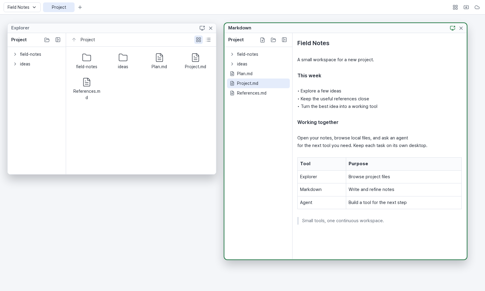
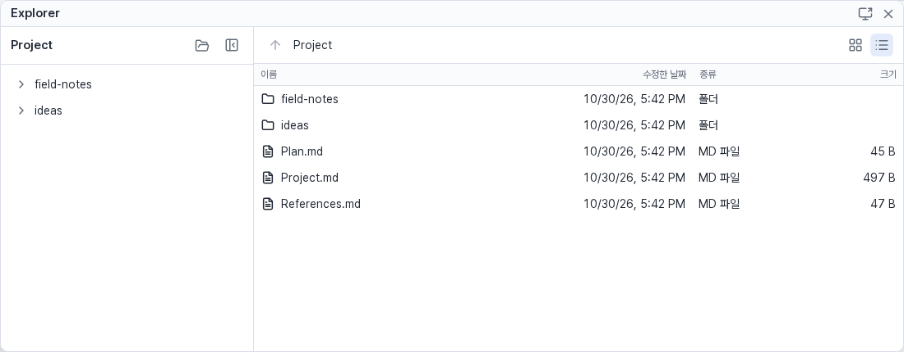
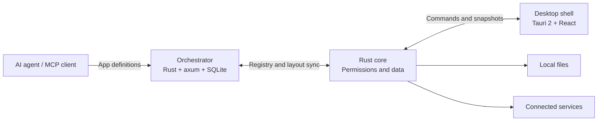
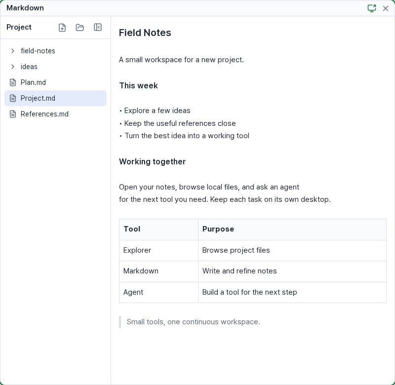

# kaleidoscope

[](https://github.com/eiaserinnys/kaleidoscope/actions/workflows/check.yml)
[](LICENSE)

**A desktop workspace for tools built by your AI agent.**

Ask an agent for a tool. It uploads a JSON app definition through MCP, and kaleidoscope opens it as a window on your desktop. Apps combine built-in UI blocks with local files, connected services, and saved state. Creating or updating an app does not require rebuilding the shell.



*Actual browser development shell with synthetic project files. The shell currently uses Korean interface labels.*

## What you can do

- **Keep a working context.** Arrange app windows across workspaces and desktops. A connected shell syncs workspaces, window layouts, and app state across devices; local folder mappings stay on each device.
- **Work with files.** Browse folders in icon or details view, open files in apps that declare their extensions, and edit Markdown in a live preview with automatic saving and conflict detection.
- **Connect your data.** Read files, folders, or service APIs and shape the results with JSONata expressions. Apps can display tables, trees, lists, feeds, code, images, and media, with inputs and actions alongside them.
- **Talk to an agent in context.** An app can connect to a `conversation-v1` provider for streaming chat and attachments. Turn on sharing for selected windows to include their visible content with your next message.
- **Reuse app settings and documents.** App storage holds account-scoped settings and Markdown documents, independently of individual windows.
- **Open web pages.** The desktop shell embeds pages in native child webviews. Installed builds check for signed updates and let you choose when to restart.



## How it fits together



The Tauri app contains a React shell and a Rust core. The core handles file access, authentication, data evaluation, and app permissions; UI blocks render the resulting values. The core is independent of Tauri and can also run behind the development HTTP bridge.

The self-hosted orchestrator stores versioned app definitions and shared workspace state, pairs devices, and exposes MCP tools to agents. The shell and server provide general capabilities; service-specific paths and data transformations belong in app definitions and named connections.

| Concept | Meaning |
| --- | --- |
| Workspace | A task context containing desktops |
| Desktop | A canvas of app windows |
| Window | An app instance with its own state and layout |
| App version | An immutable definition of blocks, bindings, permissions, and defaults |
| Block set and modules | Versioned shell capabilities an app declares it needs |

Connections support device-local OAuth login and server-side relay requests. OAuth tokens stay on the device. Relay credentials stay on the server; app definitions reference a connection by name. Files are accessed through declared permissions, including user-selected folders or explicit PC access.

## Get started

kaleidoscope is under active development. Windows is the first supported desktop target; macOS support is planned. The browser development shell is useful for local testing, but does not provide native embedded webviews or desktop updating.

### 1. Run an orchestrator

Install stable Rust, clone this repository, and start the server from its root:

```bash
git clone https://github.com/eiaserinnys/kaleidoscope.git
cd kaleidoscope
export KALEIDOSCOPE_MCP_TOKEN="$(openssl rand -hex 32)"
export KALEIDOSCOPE_DB_PATH=./kaleidoscope.db
cargo run -p kaleidoscope-orchestrator
```

The server defaults to `127.0.0.1:4219`. Keep the generated MCP token for your agent's configuration. Use `KALEIDOSCOPE_BIND` to change the listen address. For devices on another machine, expose the server through an HTTPS reverse proxy and use that address in the shell.

Windows 독립 서버에서 기기 연결 전에 기본 앱 워커를 쓰려면 릴리스의 서버 ZIP을 풀고, `apps` 폴더가 있는 디렉터리에서 서버를 실행합니다. 서버 워커에는 Python 3이 필요하며, `npx`를 쓰는 기본 에이전트에는 Node.js 22 이상과 해당 에이전트의 로그인이 필요합니다. Docker 이미지는 Python과 Node.js를 포함합니다.

### 2. Connect an MCP client

Add the orchestrator as a Streamable HTTP MCP server in your agent's MCP configuration:

```json
{
  "mcpServers": {
    "kaleidoscope": {
      "type": "http",
      "url": "http://127.0.0.1:4219/mcp",
      "headers": {
        "Authorization": "Bearer <your MCP token>"
      }
    }
  }
}
```

The exact configuration wrapper depends on your MCP client. Use the token generated in step 1, and replace the URL if the server is on another machine.

### 3. Pair the desktop shell

Download the Windows installer from [Releases](https://github.com/eiaserinnys/kaleidoscope/releases). The installer is not Authenticode-signed, so Windows may show a SmartScreen warning.

Release installers are preconfigured for the project's hosted registry. To use your own orchestrator, build a shell with `KALEIDOSCOPE_SERVER_URL` set at compile time (see Development), or use the browser development shell below. There is currently no server URL field in the desktop interface.

In a shell configured for your server, open the server connection menu and start pairing. Give the displayed code to your agent and ask it to call `approve_device`. Once approved, the shell receives the registry and shared layout.

### 4. Ask for an app

The shell includes a file explorer, Markdown editor and viewer, and web browser. Their definitions live in [apps/](apps/) and change with shell releases. Ask the agent to create a personal app with `upload_app`, using `open: true`; [examples](examples/) include a block gallery. File-based apps ask for a folder when needed. Apps using service connections or agent chat also need the corresponding connection or conversation provider; the orchestrator does not run an AI model itself.

Useful MCP tools include `list_apps`, `get_app`, `upload_app`, `delete_app`, `open_app`, `preview_app`, `list_workspaces`, `get_workspace`, `get_shared_view`, `list_devices`, and `approve_device`. The server's tool schemas describe their inputs.

## Use the built-in Agent app

Install Node.js for adapters launched with `npx`, and sign in once with each agent CLI you plan to use. Open **Agent** from the app menu, choose an agent and a working folder, then approve its displayed command the first time on that PC. This approval allows that command to run; the selected folder is not a sandbox. Chat with the agent and review its tool requests as they appear.

When the shell is connected to an orchestrator, you can also ask an agent to create or open an app in the same workspace. The Agent app's list is stored in its `agents` app-storage entry; use MCP `write_app_storage` to add or change entries. The four defaults and their commands are in [`apps/agent.json`](apps/agent.json).

## An app is a JSON definition

This minimal editor opens Markdown files from a folder the user selects:

```json
{
  "id": "notes",
  "name": "Notes",
  "requires": { "blocks": 3, "modules": { "files": 1 } },
  "permissions": [
    { "module": "files", "id": "docs", "access": "readwrite", "label": "Notes folder" }
  ],
  "state": { "file": null },
  "opens": { "extensions": ["md"], "permission": "docs", "state": "file" },
  "ui": {
    "type": "markdown_editor",
    "file": { "permission": "docs", "path": { "state": "file" } }
  }
}
```

An explorer can open `.md` files in this app through its `opens` declaration. For an editor with its own file tree, see [md-editor.json](apps/md-editor.json).

More elaborate apps add `sources` for data, JSONata bindings to transform it, and actions to update state or call a connection. Shared validation checks definitions and capability versions before accepting them. The authoritative types and documentation live in [the contract crate](crates/contract/src/lib.rs), with [data bindings and actions](crates/contract/src/data.rs), [app storage](crates/contract/src/app_storage.rs), and [the conversation protocol](crates/contract/src/conversation.rs).



*The green border marks a window selected for sharing with an agent. This capture shows local editing; no model conversation is running.*

## Development

Use stable Rust, Node.js 22, and pnpm 10.32.1. Frontend dependencies are managed as a pnpm workspace:

```bash
corepack enable
pnpm install --frozen-lockfile
cargo test
pnpm -r --if-present typecheck
pnpm -r --if-present test
```

Contract tests generate the TypeScript types in `ui/src/contract/`; commit regenerated files when the Rust contract changes.

To run the browser development shell against the real core, start the orchestrator above, then run these in separate terminals from the repository root:

```bash
cargo run -p kaleidoscope-devbridge -- --data-dir ./dev-data --port 1421 --server http://127.0.0.1:4219
```

```bash
pnpm --dir app dev
```

Open `http://localhost:1420/?core=http://127.0.0.1:1421`, then pair this shell through your local MCP client. The development bridge accepts the UI origin `http://localhost:1420`.

For desktop development on a supported host, install the [Tauri prerequisites](https://v2.tauri.app/start/prerequisites/) and set the server URL when building:

```bash
KALEIDOSCOPE_SERVER_URL=http://127.0.0.1:4219 pnpm --dir app tauri dev
```

Use `tauri build` instead of `tauri dev` for an installer. A redistributed build also needs its own updater endpoint and signing key configuration in `app/src-tauri/tauri.conf.json`. Windows release builds and native end-to-end checks run in GitHub Actions.

| Path | Contents |
| --- | --- |
| `crates/contract` | Rust contracts, validation, JSON Schema, generated TypeScript |
| `crates/core` | File access, permissions, persistence, connections, synchronization |
| `crates/data` | Shared JSONata evaluation |
| `crates/orchestrator` | Registry, device pairing, MCP, shared state |
| `crates/devbridge` | Local HTTP bridge for testing the core in a browser |
| `ui/` | Reusable blocks and rendering |
| `app/` | React desktop shell and thin Tauri host |
| `apps/` | Built-in app definitions shipped with the shell |
| `examples/` | App definitions used by examples and contract tests |

## License

[MIT](LICENSE). Copyright (c) 2026 Jubok Kim.

## 데스크톱과 내 PC 서버

설치본을 실행하면 내장 서버가 자동으로 시작됩니다. 기기 연결 코드를 입력하지 않고 기본 에이전트에서 앱을 만들고, 앱 저장소와 서버 워커를 사용할 수 있습니다. 내장 서버는 루프백 주소만 열며 데이터와 토큰은 앱 데이터 폴더의 `local-orchestrator.db`, `local-orchestrator.token`에 보존됩니다. 기존 원격 연결을 쓰던 설치본은 업데이트 후에도 그 연결을 유지합니다. 기기 연결이 거부되어도 원격 배치와 미전송 변경은 해당 서버의 상태로 보존합니다.

상단의 서버 버튼에서 원격 서버 주소를 입력하면 페어링 코드가 표시됩니다. 해당 서버의 MCP를 사용하는 에이전트에게 코드를 전달해 승인합니다. 연결 직후 내 PC의 자산, 개인 앱, 배치, 저장값을 순서대로 가져옵니다. 원격에 이미 있는 값은 보존하며 다른 내용은 건너뜁니다. 같은 메뉴의 **내 PC 앱과 데이터 가져오기**로 다시 실행하고 건너뛴 목록을 확인할 수 있습니다.

**내 PC 서버로 전환**하면 로컬 배치로 돌아갑니다. 서버별 배치와 미전송 변경은 분리 보존됩니다. 외부 서비스 연결이나 로그인 정보, 워커 시크릿은 이관하지 않으므로 대상 서버와 기기에서 설정합니다.

## 독립 서버 실행

릴리스의 `kaleidoscope-orchestrator-x86_64-pc-windows-msvc.exe`를 내려받아 실행합니다. 별도 토큰 지정이 없으면 DB 경로 뒤에 `.token`을 붙인 파일을 만들고 다음 실행에도 재사용합니다.

```sh
kaleidoscope-orchestrator --bind 127.0.0.1:4219 --db ./data/kaleidoscope.db
kaleidoscope-orchestrator --help
kaleidoscope-orchestrator --db ./data/kaleidoscope.db --print-mcp-config
```

`--print-mcp-config`는 인증 토큰이 포함된 MCP 설정 JSON을 표준 출력으로 내보냅니다. 개인 에이전트 설정에만 저장합니다. 보통 실행 로그에는 토큰 값을 출력하지 않습니다. `--token`, `--token-file`을 지정할 수 있으며 기존 `KALEIDOSCOPE_BIND`, `KALEIDOSCOPE_DB_PATH`, `KALEIDOSCOPE_MCP_TOKEN` 환경변수도 지원합니다. CLI 옵션이 환경변수보다 우선합니다.

```sh
docker compose up -d --build
docker compose logs orchestrator
```

Compose의 데이터 볼륨에 DB, 토큰과 백업을 보존하며 호스트 루프백의 4219 포트를 엽니다. 다른 PC에서 쓰려면 인증서를 둔 HTTPS 역방향 프록시를 연결합니다. 서버 워커를 쓰는 앱은 실행 환경에 필요한 의존성을 설치합니다. 기본 이미지는 Python 3를 포함합니다.

서버 워커의 Python 3 실행 파일은 Linux에서는 `python3`, Windows에서는 `python`을 사용합니다. 데스크톱에서 Python 워커를 실행하려면 해당 실행 파일이 PATH에 있어야 합니다.
