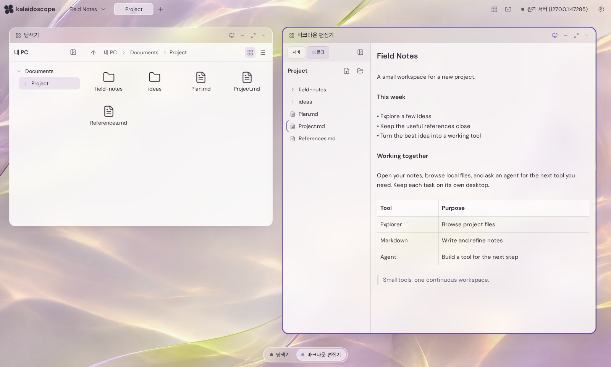
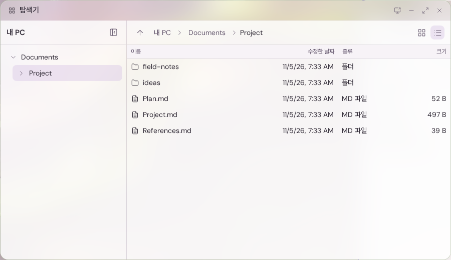
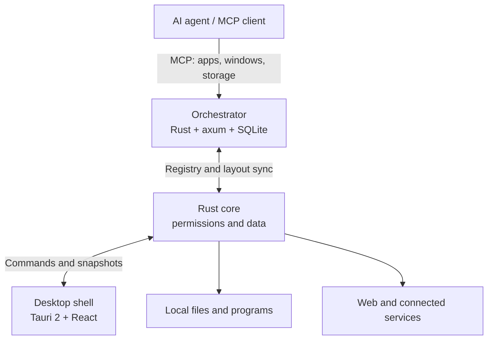
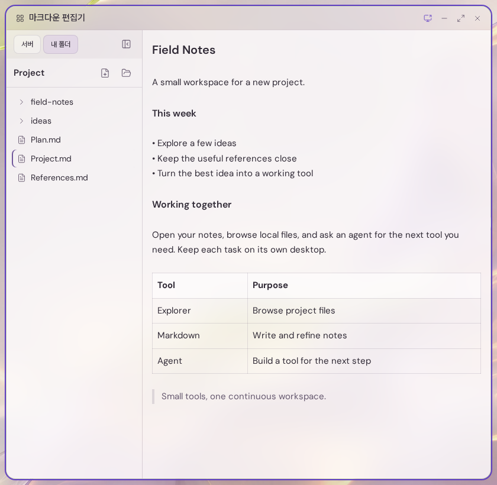

# kaleidoscope

[](https://github.com/eiaserinnys/kaleidoscope/actions/workflows/check.yml)
[](LICENSE)

**A desktop workspace for tools built by your AI agent.**

Ask an agent for a tool. It uploads a JSON app definition through MCP, and kaleidoscope opens it as a window on your desktop. Apps combine built-in UI blocks with local files, web data, connected services, and saved state. Creating or updating an app does not require rebuilding the shell.



*Browser development shell with synthetic project files. The shell's interface labels are currently in Korean.*

## What you can do

- **Keep a working context.** Arrange app windows across workspaces and desktops. When the shell is connected to a server, workspaces, window layouts, and app state follow you across devices; folder choices stay on each device.
- **Work with files.** Browse your known folders and drives in icon or details view, open files in apps that declare their extensions, and edit Markdown in a live preview with automatic saving and conflict detection.
- **Connect your data.** Read files, folders, public HTTPS APIs, or signed-in services and shape the results with JSONata expressions. Apps show them as tables, trees, lists, feeds, timelines, code, images, and media, with inputs and actions alongside. Long lists keep loading as you scroll.
- **Work with an agent in the shell.** The built-in Agent app runs an agent CLI in a folder you choose, and that agent can build and open apps for you. Turn on sharing for a window, and agents can read what it shows and operate it.
- **Go past the blocks when needed.** Per-window JavaScript draws on a canvas, existing HTML runs in an isolated frame, Python workers run on the server on a schedule or webhook, and apps can start programs you have approved on this PC.
- **Open web pages.** The desktop shell embeds pages in native child webviews. Installed builds check for signed updates and let you choose when to restart.



## How it fits together



The Tauri app contains a React shell and a Rust core. The core handles file access, authentication, data evaluation, app permissions, and real-time connections; UI blocks render the resulting values. The core is independent of Tauri and can also run behind the development HTTP bridge.

The orchestrator stores versioned app definitions and shared workspace state, pairs devices, runs app workers, and exposes MCP tools to agents. Every desktop shell starts one of its own on the loopback address, so a single PC needs no setup. Run a separate orchestrator to share a workspace between devices or to reach it from an agent outside the shell. The shell and server provide only general capabilities; service-specific paths and data transformations belong in app definitions and named connections.

| Concept | Meaning |
| --- | --- |
| Workspace | A task context containing desktops |
| Desktop | A canvas of app windows |
| Window | An app instance with its own state and layout |
| App version | An immutable definition of blocks, bindings, permissions, and defaults |
| Block set and modules | Versioned shell capabilities an app declares it needs |

Connections support device-local OAuth login and server-side relay requests. OAuth tokens stay on the device. Relay credentials stay on the server; app definitions reference a connection by name. Files are accessed through declared permissions: a folder the user picks for a window, or PC-wide read access the user allows once per app.

## Get started

kaleidoscope is under active development. Windows is the first supported desktop target; macOS support is planned.

### 1. Install the shell

Download the [Windows installer](https://kaleidoscope.eiaserinnys.me/releases/kaleidoscope_x64-setup.exe). It is not Authenticode-signed, so Windows may show a SmartScreen warning. Installed shells update themselves from the same place. Before installing an update, the shell shows what changed and asks for confirmation.

The shell starts its built-in server on launch. Its database and token are kept in the app data folder as `local-orchestrator.db` and `local-orchestrator.token`.

### 2. Start the Agent app

Open **에이전트** (Agent) from the app grid (`앱 열기` at the left of the bottom bar), pick an agent and a working folder, and approve its command the first time on that PC. The defaults are Claude Code, Codex, Gemini CLI, and Antigravity, launched through the Agent Client Protocol. If the command's program is missing, the window offers to install it and then starts the agent. Sign in once with each agent CLI you plan to use.

The approval lets that command run with your account's permissions; the working folder is not a sandbox. Agents that accept HTTP MCP servers receive the shell's MCP tools, so you can ask one to build an app and it opens as a new window. The list of agents is stored in the Agent app's `agents` storage entry; change it with the MCP tool `write_app_storage`. The defaults are in [`apps/agent.json`](apps/agent.json).

### 3. Run your own server (optional)

Run a separate orchestrator to use an agent outside the shell, such as a terminal CLI, or to share one workspace across devices. Build it from source with stable Rust:

```bash
git clone https://github.com/eiaserinnys/kaleidoscope.git
cd kaleidoscope
cargo run -p kaleidoscope-orchestrator -- --db ./data/kaleidoscope.db --print-mcp-config
```

The server listens on `127.0.0.1:4219`. On first start it creates a token next to the database (`./data/kaleidoscope.db.token`) and reuses it afterwards. `--print-mcp-config` writes an MCP configuration containing that token to standard output; keep it only in your own agent settings. Other options are `--bind`, `--token`, and `--token-file`; the environment variables `KALEIDOSCOPE_BIND`, `KALEIDOSCOPE_DB_PATH`, and `KALEIDOSCOPE_MCP_TOKEN` also work, and command-line options take precedence.

On Windows, you can instead download `kaleidoscope-orchestrator-x86_64-pc-windows-msvc.zip` from [Releases](https://github.com/eiaserinnys/kaleidoscope/releases). It contains the server and the built-in app definitions in `apps/`; run the server from that folder so built-in app workers work before any shell connects. With Docker, `docker compose up -d --build` builds an image that keeps the database, token, and backups in a volume and publishes port 4219 on the host's loopback address.

App workers run Python 3 (`python3` on Linux, `python` on Windows), which must be on the server's PATH. The Docker image includes Python and Node.js. For devices on another machine, put the server behind an HTTPS reverse proxy and use that address in the shell.

### Run a private app store

Download `kaleidoscope-store-server-x86_64-pc-windows-msvc.exe` from Releases, or build it with `cargo build --release -p kaleidoscope-store-server`. Both command-line flags are required:

```text
kaleidoscope-store-server --bind 0.0.0.0:4230 --data-dir ./store-data
```

The server serves the version 1 store index and accepts app folders through `POST /publish` as multipart files. Publishing the same contents keeps the existing release; changed contents create a new release. It has no login or approval: bind it only where your private network controls access.

### 4. Connect an MCP client

Add the printed configuration to your agent's MCP settings. It describes a Streamable HTTP server:

```json
{
  "mcpServers": {
    "kaleidoscope": {
      "type": "http",
      "url": "http://127.0.0.1:4219/mcp",
      "headers": {
        "Authorization": "Bearer <your MCP token>"
      }
    }
  }
}
```

The wrapper around the server entry depends on your MCP client. Replace the URL if the server is on another machine.

### 5. Pair the shell

Click the server label at the top right of the shell (it reads `내 PC 서버` while the shell uses its built-in server) to open the server section of the settings. Enter the address under `원격 서버 주소` (remote server address) and choose `연결` (connect). Give the displayed pairing code to your agent and ask it to call `approve_device`. Once approved, the shell copies this PC's assets, personal apps, layouts, and stored values to the server, keeping anything the server already has; `내 PC 앱과 데이터 가져오기` runs the copy again and lists what was skipped. Service connections, sign-ins, and worker secrets are not copied, so set them up again for the new server.

`내 PC 서버로 전환` switches back to the built-in server. Layouts and unsent changes are kept separately for each server.

### 6. Ask for an app

The shell ships with built-in apps such as the file explorer, Markdown editor, web browser, and Agent; their definitions live in [apps/](apps/) and change with shell releases. Ask the agent to create a personal app with `upload_app`, which also opens it; [examples](examples/) include a block gallery. You can also load a definition file yourself with `앱 정의 가져오기` (import app definition) next to the app menu. Apps that use files ask for a folder when needed. Apps that use service connections need the connection set up first; the orchestrator does not run an AI model itself.

Agents work with the shell through these MCP tools:

| Area | Tools |
| --- | --- |
| Apps | `list_apps`, `get_app`, `preview_app`, `upload_app`, `open_app`, `delete_app` |
| Workspaces and devices | `list_workspaces`, `get_workspace`, `delete_workspace`, `list_devices`, `approve_device`, `revoke_device` |
| Shared windows | `get_shared_view`, `read_window`, `act_window` |
| App storage and assets | `list_app_storage`, `read_app_storage`, `write_app_storage`, `move_app_storage`, `reset_app_storage`, `list_assets`, `get_asset`, `upload_asset` |
| Connections and workers | `list_connections`, `set_connection`, `delete_connection`, `list_app_secrets`, `set_app_secret`, `delete_app_secret`, `invoke_app_worker`, `get_app_worker_status`, `list_worker_runs` |

The server's tool descriptions and input schemas are the reference for their arguments.

## An app is a JSON definition

This minimal editor opens Markdown files from a folder the user selects:

```json
{
  "id": "notes",
  "name": "Notes",
  "requires": { "blocks": 3, "modules": { "files": 1 } },
  "permissions": [
    { "module": "files", "id": "docs", "access": "readwrite", "label": "Notes folder" }
  ],
  "state": { "file": null },
  "opens": { "extensions": ["md"], "permission": "docs", "state": "file" },
  "ui": {
    "type": "markdown",
    "file": { "permission": "docs", "path": { "state": "file" } }
  }
}
```

The explorer can open `.md` files in this app through its `opens` declaration. For an editor with its own file tree, see [md-editor.json](apps/md-editor.json).

Larger apps add `sources` for data, JSONata bindings to transform it, and actions that update state or call a connection. `client` scripts, `worker` code, `storage` entries, and `assets` cover what blocks alone cannot. The server checks every definition and the capability versions it requires before accepting it, and errors name what failed and where. The authoritative types and documentation live in [the contract crate](crates/contract/src/lib.rs), with [data bindings and actions](crates/contract/src/data.rs), [app storage](crates/contract/src/app_storage.rs), [client scripts](crates/contract/src/client.rs), [workers](crates/contract/src/worker.rs), and [the conversation protocol](crates/contract/src/conversation.rs).



*The colored ring marks a window shared with an agent. This capture shows local editing; no agent is running.*

## Share apps through the store

The app store is the public repository [eiaserinnys/kaleidoscope-appstore](https://github.com/eiaserinnys/kaleidoscope-appstore). Each app is one folder, `apps/{id}/`, holding its store metadata, the app definition, assets, and screenshots. To publish, open a pull request there; merging it is the approval. Checks on the pull request report problems to the author before review. Merged apps are copied to a static site at [kaleidoscope.eiaserinnys.me/appstore](https://kaleidoscope.eiaserinnys.me/appstore/).

Any HTTPS address that serves the same static format works as a store. An app reads a store with a `store` source and installs a release with the `store.install` action; the shell shows the permissions an app asks for before installing it.

## Development

Use stable Rust, Node.js 22, and pnpm 10.32.1. Frontend dependencies are managed as a pnpm workspace:

```bash
corepack enable
pnpm install --frozen-lockfile
cargo test
pnpm -r --if-present typecheck
pnpm -r --if-present test
```

Contract tests generate the TypeScript types in `ui/src/contract/`; commit regenerated files when the Rust contract changes. Errors are registered in `crates/contract/src/errors/`, one code per place and cause; `cargo run -p kaleidoscope-contract --example error_catalog <area>` prints an area's table.

To run the browser development shell against the real core, start these in separate terminals from the repository root:

```bash
cargo run -p kaleidoscope-devbridge -- --data-dir ./dev-data --port 1421
```

```bash
pnpm --dir app dev
```

Open `http://localhost:1420/?core=http://127.0.0.1:1421`. The bridge starts its own built-in server, as the desktop shell does, and accepts only the UI origin `http://localhost:1420`. To try a separate orchestrator, start one as in Get started and connect to it from the server section of the settings. The browser shell has no native webviews or updater. Native dialogs are replaced by environment variables on the bridge:

| Variable | Effect |
| --- | --- |
| `KALEIDOSCOPE_DEV_PICK` | Folder returned when a window asks for a folder |
| `KALEIDOSCOPE_DEV_PICK_FILES` | JSON array of absolute file paths returned by the file picker, such as `["/tmp/sample.txt"]`. Unset or empty cancels the pick |
| `KALEIDOSCOPE_DEV_PICK_SAVE_FILE` | Path returned by the save dialog |
| `KALEIDOSCOPE_DEV_PC_ROOTS` | JSON array of `{"id", "kind", "name", "path"}` roots the explorer shows as this PC; `kind` is `known` or `volume` |

For desktop development on a supported host, install the [Tauri prerequisites](https://v2.tauri.app/start/prerequisites/) and run:

```bash
pnpm --dir app tauri dev
```

Use `tauri build` instead of `tauri dev` for an installer. A redistributed build also needs its own updater endpoints and signing key in `app/src-tauri/tauri.conf.json`. Windows release builds and native end-to-end checks run in GitHub Actions.

| Path | Contents |
| --- | --- |
| `crates/contract` | Rust contracts, validation, error registry, JSON Schema, generated TypeScript |
| `crates/core` | File access, permissions, persistence, connections, store installs, synchronization |
| `crates/data` | Shared JSONata evaluation |
| `crates/orchestrator` | Registry, device pairing, MCP, workers, shared state; also embedded in the shell |
| `crates/devbridge` | Local HTTP bridge for testing the core in a browser |
| `crates/acp-test-agent` | Offline agent with fixed responses for Agent app tests |
| `ui/` | Reusable blocks and rendering |
| `app/` | React desktop shell and thin Tauri host |
| `apps/` | Built-in app definitions shipped with the shell, with the Agent app's client source and assets |
| `examples/` | App definitions used by examples and contract tests |
| `e2e/` | Window-control scenarios run against a local test shell |

## License

[MIT](LICENSE). Copyright (c) 2026 Jubok Kim.
